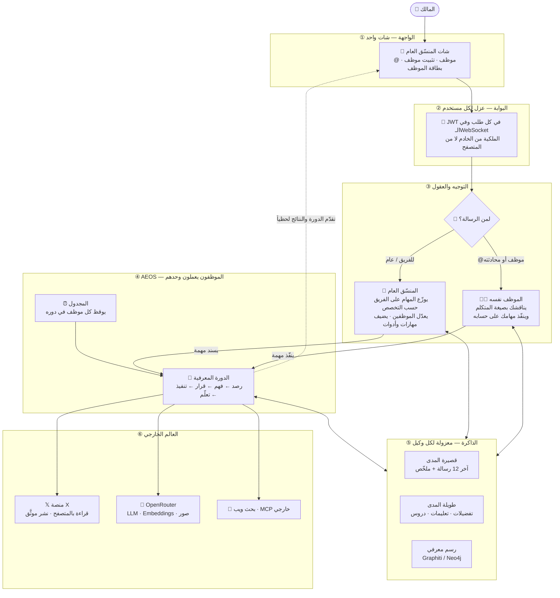
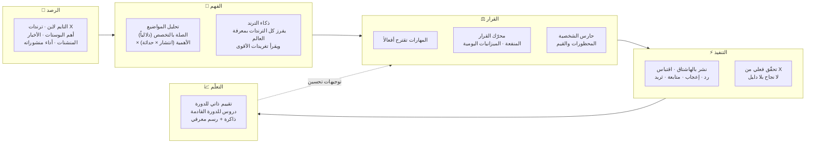
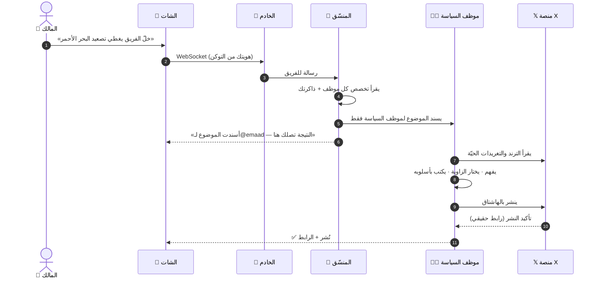

<div dir="rtl">

# 🌊 موج — منصّة الموظفين الأذكياء لإدارة حسابات X

**موج** منصّة وكلاء ذكية متعددة: تسجّل الدخول فيستقبلك **المنسّق العام** في شات واحد، ومن خلاله تدير
فريقاً من **الموظفين الأذكياء** — كل موظف وكيل فرعي يدير حساب X بشخصيته وتخصصه ومهاراته وذاكرته
وجدوله، ويعمل وحده على مدار اليوم: يرصد التايم لاين والترند والأخبار، يفهم ما يخص تخصصه، يقرّر،
ينشر ويتفاعل، ثم يقيّم نفسه ويتعلّم.

> **الوضع الحالي:** يعمل على هذا الجهاز (FastAPI + React)، والمزوّد الذكي OpenRouter.
> التفاصيل المعمارية الكاملة (8 مخططات): [`docs/ARCHITECTURE.md`](docs/ARCHITECTURE.md).

---

## 🧭 كيف يعمل النظام

</div>



<div dir="rtl">

### دورة الموظف الذكي — ماذا يحدث في كل استيقاظ

</div>



<div dir="rtl">

### مثال: من رسالتك إلى تغريدة منشورة

</div>



<div dir="rtl">

---

## ✨ المميزات

### 🧭 المنسّق العام (الوكيل الرئيسي)
- شات واحد تدير منه الفريق كاملاً بلغتك الطبيعية.
- **توجيه هجين:** الأوامر الواضحة تُنفَّذ مباشرة، و`@موظف` يخاطب الموظف نفسه، والطلبات العامة يتولاها المنسّق.
- يوزّع المهام حسب التخصص، ويعدّل الموظفين (الشخصية، الجدول، الاهتمامات) **دون لمس ما لم تطلبه**.
- يضيف مهارات وأدوات، ويستنسخ هويات، ويتذكّر تفضيلاتك عبر الجلسات. **لا يحذف موظفاً أبداً.**

### 🧑‍💼 الموظفون الأذكياء (الوكلاء الفرعيون)
- كل موظف: حساب X + شخصية + تخصص + مهارات + أدوات + ذاكرة + جدول عمل.
- **تحليل مواضيع دلالي:** يفهم المعنى لا الكلمات، ويرتّب بالأهمية الحقيقية (مشاهدات، تفاعل، حداثة).
- **ذكاء الترند:** يكتشف الهاشتاق الذي يخص تخصصه (مثلاً `#الحوثي` لموظف سياسة) ولو لم يحوِ أي كلمة مفتاحية، ويقرأ تغريداته، ويختار المشاركة الصحيحة: منشور بالهاشتاق، أو اقتباس للتغريدة المحورية، أو رد.
- **استنساخ الهوية بعمق:** بصمة صوت من التغريدات والردود مع سياقها، ودليل ردود حسب نبرة المخاطَب.
- **ناقشه مباشرة:** `@الموظف` يفتح نقاشاً معه بصيغة المتكلم، وينفّذ ما تطلبه.
- **يتعلّم من نفسه:** تقييم بعد كل دورة، ودروس تُطبَّق في الدورة التالية.

### 🧠 الذاكرة
- **قصيرة المدى:** آخر 12 رسالة حرفياً + ملخّص متدحرج لما قبلها (محادثات طويلة بلا تضخّم).
- **طويلة المدى:** تفضيلات وتعليمات وقرارات تُستخرج تلقائياً من كلامك أنت فقط، مع دمج للمكرّر واسترجاع بالصلة والأهمية.
- **رسم معرفي زمني** (Graphiti/Neo4j) لحقائق الحسابات والعلاقات.
- **عزل تام:** لا يرى موظف ذاكرة زميله، ولا يرى أحد ذاكرة المنسّق إلا مالكها. حذف أي مالك يمحو كل ما يخصه.

### 🔌 المهارات والأدوات — مستويان
- **قدرات النظام** (`system/`، يثبّتها المطوّر من لوحة التحكم): مدمجة لمنسّق كل مالك، ويربط المالك موظفيه بما أُتيح لهم.
- **قدرات الموظف الخاصة** (يضيفها المالك من بطاقة الموظف، لذلك الموظف وحده):
  - **مهارات مخصّصة** تكتبها بلغتك («كل صباح ردّ على أهم تغريدة عن النفط») أو ترفعها كملف.
  - **أدوات MCP خاصة**: خادم HTTP عام بنموذج أو ملف إعداد JSON — تُكتشف أدواته وتُربط بالموظف، وأسرارها خارج git وتُحذف معه. (stdio والعناوين الداخلية للمطوّر فقط.)
- **بحث ويب حقيقي** عبر Tavily قبل الكتابة (المزوّد الوحيد للبحث وللترندات).
- **مهارة تلقائية `system_tools`**: أي أداة MCP تُضاف للنظام (مثل Tavily) أو للموظف يكتشفها كل موظف ويصنّفها (بحث / قراءة صفحات / أخبار) ويستخدمها قبل كتابة المنشورات والاقتباسات — دون ربط يدوي، ما لم يفصلها المالك من بطاقة الموظف.

### 🛠️ لوحة التحكم وقدرات النظام (`/admin`)
- **الأدوار:** مستخدم · مسؤول (عرض وإدارة المستخدمين) · **مطوّر** (وحده يضيف خوادم MCP ومهارات النظام ويمنح دور المطوّر).
- **مجلد رئيسي واحد `system/`** فيه **كل** خوادم MCP وكل المهارات — لا تسجيل في أي مكان آخر.
- **خوادم MCP** (`system/mcps/`): الثمانية الأصلية (X، قراءة X، المحتوى، الذاكرة، المتصفح، الأخبار، البحث، الصور) والمرفوعة معاً. الرفع ملف `.json` بصيغة `mcpServers` أو حزمة `.py`/`.zip`؛ يتصل النظام بالخادم ويكتشف أدواته، ثم يصير **مدمجاً** مثل الأصلي ويتصل به منسّق كل مالك. المنسّق يصل لكل الخوادم إلا النشر/التفاعل على X وذاكرة الموظفين، وقراءة X بحسابات مالكه فقط.
- **المهارات** (`system/skills/`): مهارات **المنسّق** (`SKILL.md` — يرى الاسم والوصف ويحمّل التعليمات عند الحاجة؛ ثلاث مدمجة: تقرير الفريق، تخطيط حملة، تهيئة موظف) ومهارات **الموظفين** الإحدى عشرة (`SKILL.md` + `skill.py`). المرفوع من اللوحة مهارات منسّق فقط.
- **المستخدمون والصلاحيات:** جدول المستخدمين مع تغيير الدور، ومصفوفة الصلاحيات.
- الأسرار (`env`/`headers`) في `data/` خارج git ولا تُعرض مرة أخرى.

### 🔐 الأمان والعزل
- تسجيل دخول إلزامي على كل نقطة، والهوية من التوكن فقط (لا يُصدَّق أي `user_id` من المتصفح).
- كل مستخدم يرى موظفيه وحساباته ومحادثاته وذاكرته فقط، وغير المالك يرى «غير موجود».
- روابط الإشعارات الداخلية موقّعة، وكل الخوادم تعمل على هذا الجهاز فقط افتراضياً.
- **لا يُعلَن نجاح أي فعل على X دون تحقّق فعلي** (حتى على مستوى استجابات الشبكة للثريدات).

---

## 🚀 التشغيل

### المتطلبات
| المكوّن | الإصدار | ملاحظة |
|---|---|---|
| Python | 3.12 | البيئة الافتراضية `venv\` |
| Node.js | 18 أو أحدث | للواجهة |
| Playwright + Chromium | — | قراءة X والنشر عليه |
| مفتاح OpenRouter | — | [openrouter.ai/keys](https://openrouter.ai/keys) |
| Neo4j | اختياري | الرسم المعرفي (Graphiti) |
| Redis | اختياري | إبطال التوكنات عند تسجيل الخروج |

### التثبيت

</div>

```powershell
git clone https://github.com/Mrsos07/Moj-Agentic-AI.git
cd Moj-Agentic-AI

python -m venv venv
.\venv\Scripts\python.exe -m pip install -r requirements.txt
.\venv\Scripts\python.exe -m playwright install chromium

cd frontend; npm install; cd ..
copy .env.example .env      # ثم عدّل القيم
```

<div dir="rtl">

### أهم متغيرات `.env`

| المتغير | الوصف |
|---|---|
| `OPENROUTER_API_KEY` | **مطلوب** — مفتاح المزوّد الذكي |
| `OPENROUTER_MODEL` | الموديل **مؤهّلاً بالمزوّد**: `openai/gpt-4o-mini` (لا `gpt-4`) |
| `JWT_SECRET_KEY` | **مطلوب** — 32 حرفاً على الأقل (وإلا تنتهي الجلسات مع كل تشغيل) |
| `TAVILY_API_KEY` | البحث على الويب وكاشف الترندات (Tavily المزوّد الوحيد) |
| `OPENROUTER_EMBEDDING_MODEL` | لا تغيّره بعد بدء الاستخدام: يغيّر أبعاد المتجهات |
| `BIND_HOST` / `VITE_HOST` | `0.0.0.0` لإتاحة النظام لأجهزة أخرى (الافتراضي: هذا الجهاز فقط) |

### التشغيل

</div>

```powershell
# الخادم (يشغّل AEOS ويستدعي خوادم X الداخلية تلقائياً)
.\venv\Scripts\python.exe run.py

# الواجهة — في نافذة ثانية
cd frontend; npm run dev
```

<div dir="rtl">

افتح **http://localhost:3000** وسجّل الدخول.

| الخدمة | المنفذ |
|---|---|
| الواجهة (Vite) | 3000 |
| الخادم الرئيسي (FastAPI + WebSocket) | 8000 |
| X Suite — تنفيذ أفعال X | 5789 |
| LoginX — تسجيل دخول الحسابات | 5000 |
| Identity — توليد الهويات | 5990 |
| Neo4j (اختياري) | 7687 |

---

## 💬 أمثلة من الشات

| تكتب | يحدث |
|---|---|
| `وش وضع الفريق اليوم؟` | المنسّق يعرض أداء كل موظف بأرقام حقيقية |
| `خلّ الفريق يغطي قمة الرياض` | المنسّق يسند الموضوع للموظف المختص |
| `@emaad5079` | الموظف يرحّب ويقترح مهاماً من واقع بياناته |
| `@emaad5079 وش رأيك نسوي سلسلة عن اليمن؟` | نقاش مع الموظف نفسه |
| `@emaad5079 روح للتايم لاين ورد على أهم تغريدة سياسية` | مهمة حرّة يختار هدفها بنفسه |
| `خلّ عماد يشتغل كل 45 دقيقة` | تعديل الجدول فقط دون لمس غيره |
| `أضف لعماد مهارة: كل صباح علّق على أهم خبر نفط` | مهارة مخصّصة تعمل تلقائياً |
| `استنسخ هوية @فلان لعماد` | بصمة صوت كاملة في الخلفية + درجة المطابقة |
| `تذكّر دائماً: ما نكتب عن الرياضة` | ذاكرة دائمة يلتزم بها الفريق |

---

## 🗂️ بنية المشروع

</div>

```
Moj-Agentic-AI/
├── run.py                       # تشغيل الخادم (إعادة تحميل ذاتية الإصلاح)
├── app/
│   ├── main.py                  # FastAPI · WebSocket · التوجيه الهجين
│   ├── auth/                    # JWT · ownership.py (العزل) · roles.py (الأدوار) · internal.py
│   ├── api/                     # REST: الحسابات · المحادثات · X · الجدولة · لوحة التحكم
│   ├── aeos/                    # نظام تشغيل الموظفين الأذكياء
│   │   ├── bootstrap.py         #   تركيب المنصة: الأطوار · الخوادم · القدرات · المهارات
│   │   ├── services/            #   orchestrator.py (المنسّق) · الاستنساخ · الأدوات
│   │   ├── cognition/           #   الدورة المعرفية (18 طوراً) · التقييم الذاتي
│   │   ├── employee/            #   النماذج · topic_intel · trend_intel · voice_profile · strategy
│   │   ├── skills/              #   المساعدات المشتركة · المخصّصة · محمّل system/skills
│   │   ├── capabilities/        #   34 قدرة (نشر · رد · اقتباس · بحث · ...)
│   │   ├── decision/            #   محرّك القرار والميزانيات
│   │   ├── mcp/                 #   catalog.py (محمّل system/mcps) · عميل MCP الخارجي
│   │   ├── memory/              #   agent_memory · lifecycle · Graphiti
│   │   └── api/routes.py        #   /api/aeos/*
│   ├── x/                       # X Suite (5789) و LoginX (5000)
│   └── core/llm_provider.py     # resolve_llm() — مصدر وحيد لإعدادات المزوّد
├── system/                      # المجلد الرئيسي: كل خوادم MCP وكل المهارات (يديرها المطوّر)
│   ├── mcps/<slug>/             #   mcp.json + server.py — 8 أصلية + المرفوعة
│   └── skills/<name>/           #   SKILL.md (+ skill.py لمهارات الموظفين) — منسّق وموظفون
├── frontend/src/                # React: ChatInterface · TeamBar · AgentsDrawer · admin/ ...
├── docs/ARCHITECTURE.md         # المعمارية التفصيلية (8 مخططات)
├── AGENTS.md                    # ملاحظات تقنية لمن يطوّر المشروع
└── verify_*.py                  # فحوص التحقق (بلا نشر على X)
```

<div dir="rtl">

---

## ✅ فحوص التحقق

كلها تعمل **بلا نشر على X** وأغلبها بلا شبكة، وبعضها على قاعدة بيانات مؤقتة:

</div>

```powershell
$env:PYTHONUTF8=1
foreach ($v in 'verify_isolation','verify_security','verify_system_admin','verify_learning',
               'verify_trend_intel','verify_memory','verify_coordinator',
               'verify_voice','verify_tools','verify_creator','verify_interaction',
               'verify_custom_skill','verify_mission','verify_critique') {
  .\venv\Scripts\python.exe "$v.py"
}
cd frontend; npm run build
```

<div dir="rtl">

| الفحص | يتحقق من |
|---|---|
| `verify_isolation.py` | كل نقاط الـAPI ترفض المجهول (تعداد تلقائي)، وعدم تسرّب أي بيانات بين المستخدمين، وعدم ترك ذاكرة يتيمة |
| `verify_system_admin.py` | الأدوار، ورفع خادم MCP حقيقي (JSON وحزمة) واكتشاف أدواته وظهورها في المنسّق، ومهارات SKILL.md |
| `verify_security.py` | حجب الأسرار من السجلات، وأسرار الخوادم الداخلية، وحماية loginx، وحدّ محاولات الدخول |
| `verify_learning.py` | التعلّم الذاتي من الدورات (الإيقاف المؤقت، منحنى الأداء، فاعلية الدروس) |
| `verify_trend_intel.py` | اكتشاف الترند المرتبط بالتخصص وطريقة المشاركة الصحيحة |
| `verify_memory.py` | الذاكرة قصيرة وطويلة المدى والعزل بين الوكلاء |
| `verify_coordinator.py` | أدوات المنسّق ووضع الموظف المخاطَب |
| `verify_openrouter.py` | إعداد المزوّد الذكي (`--config-only` بلا شبكة) |

---

## 🛠️ حل المشاكل

| العَرَض | السبب والحل |
|---|---|
| `ECONNREFUSED 127.0.0.1:8000` في Vite لثوانٍ | الخادم يعيد التحميل بعد تعديل الكود — ينتهي وحده |
| المنفذ 8000 يقبل الاتصال ولا يرد | عملية إعادة تحميل عالقة — أعد تشغيل `run.py` (ينظّف المنفذ تلقائياً) |
| `charmap codec` عند طباعة العربية | `$env:PYTHONUTF8=1` قبل تشغيل السكربتات |
| كل ردود الذكاء فارغة | اسم الموديل غير مؤهّل — استخدم `openai/gpt-4o-mini` |
| الواجهة تعيدك لتسجيل الدخول | انتهت صلاحية التوكن أو تغيّر `JWT_SECRET_KEY` |
| لا يمكن فتح النظام من جهاز آخر | مقصود — اضبط `BIND_HOST=0.0.0.0` و`VITE_HOST=0.0.0.0` |

---

## 📚 مراجع

- [`docs/ARCHITECTURE.md`](docs/ARCHITECTURE.md) — المعمارية التفصيلية: التوجيه، الدورة المعرفية، الذاكرة، العزل، MCP.
- [`AGENTS.md`](AGENTS.md) — قواعد تقنية مهمة للتطوير (المزوّد، الرسم المعرفي، التحقق من أفعال X).

**المطوّر:** [@Mrsos07](https://github.com/Mrsos07)

</div>
