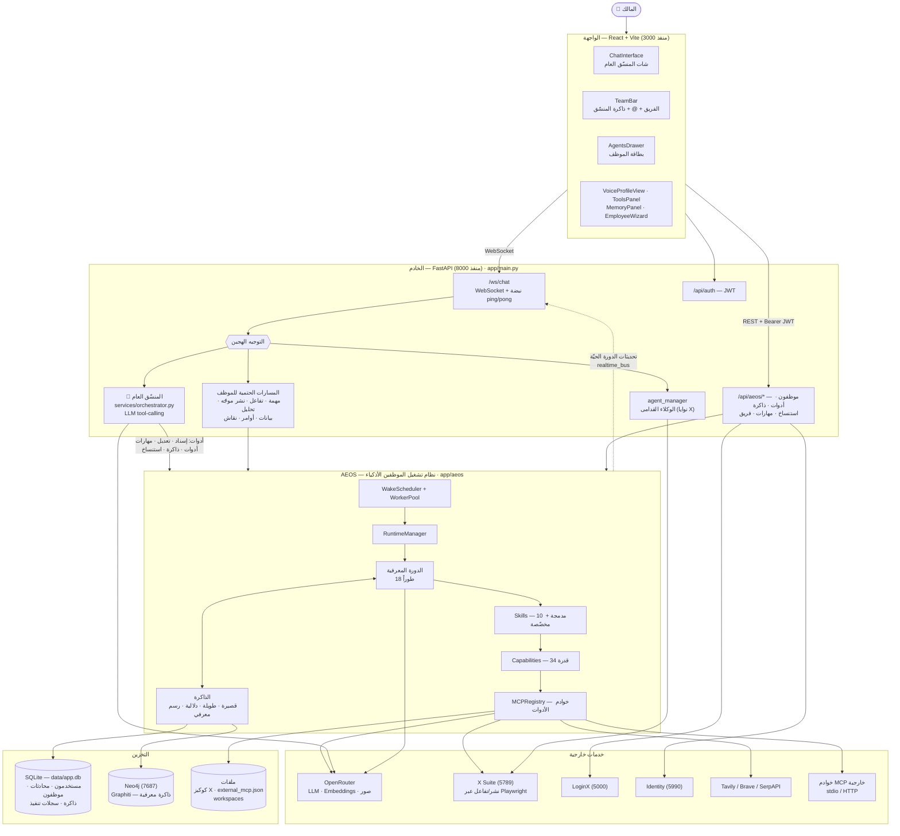
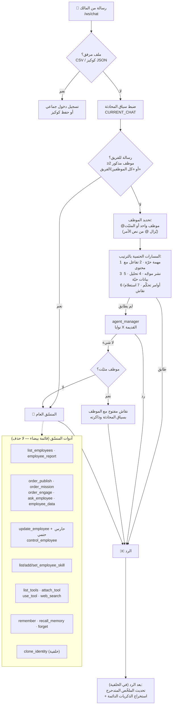
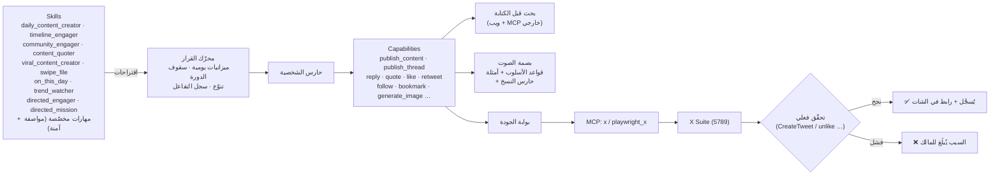
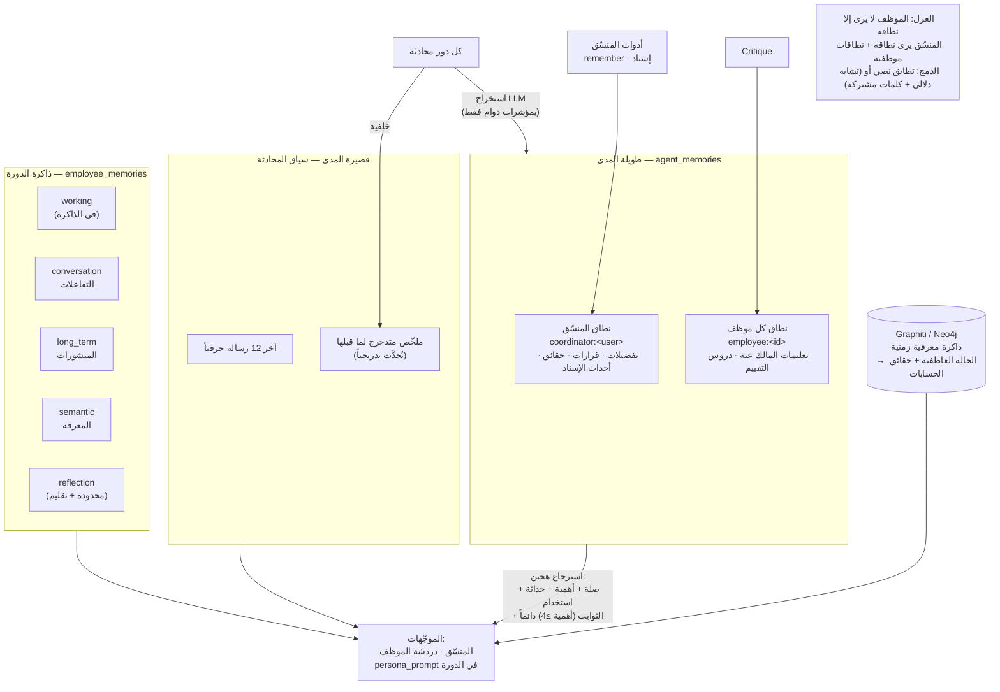
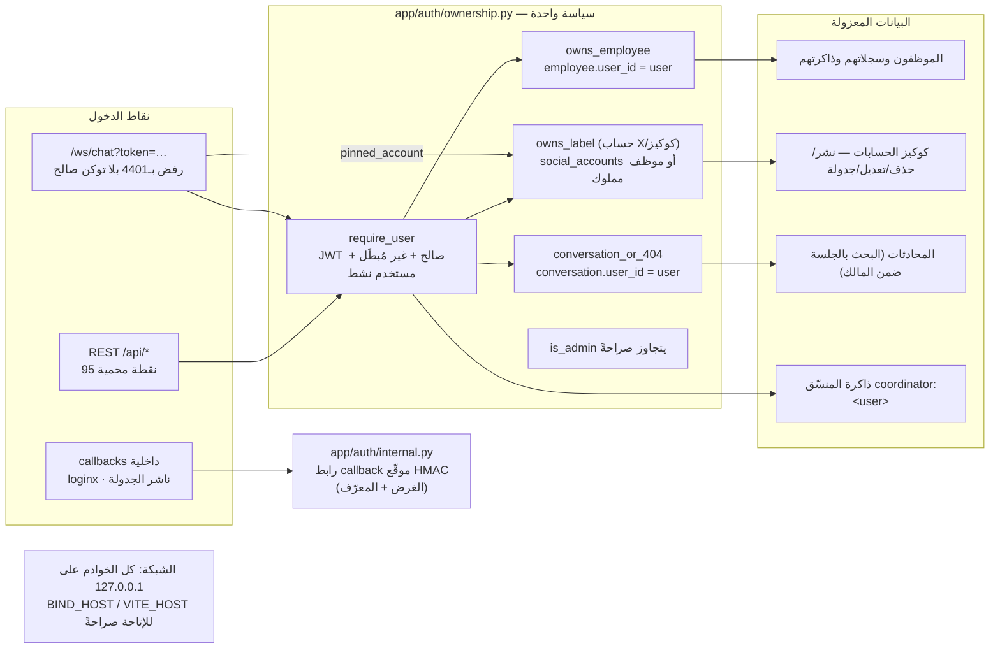
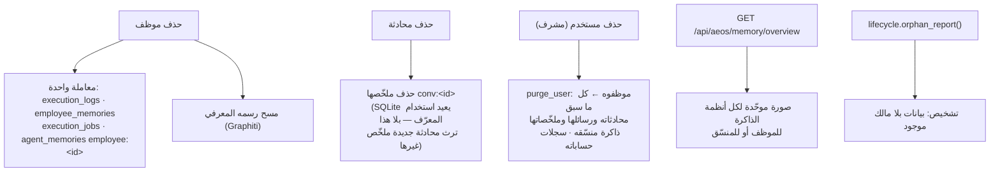
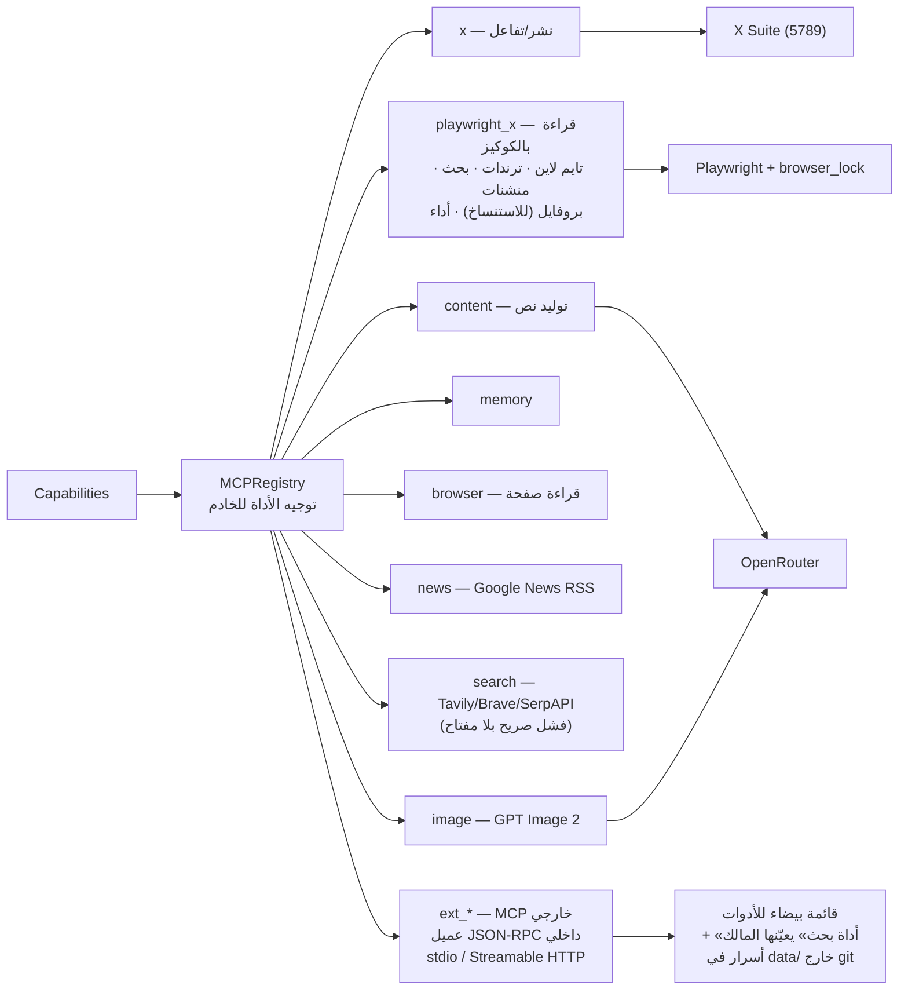

# معمارية نظام Moj Agentic AI

> مخططات Mermaid تُعرض مباشرة على GitHub وفي VS Code (إضافة Markdown Preview Mermaid).
> مطابقة للكود الحالي (تشمل طبقة العزل الموحّدة ودورة حياة الذاكرة وذكاء الترند).

---

## 1) نظرة عامة — الطبقات والخدمات

---

## 2) مسار رسالة الشات — التوجيه الهجين

---

## 3) الدورة المعرفية للموظف (الوكيل الفرعي)

```mermaid
flowchart LR
    WAKE(["⏰ إيقاظ<br/>جدولة · منشن · أمر من الشات"]) --> O

    subgraph SENSE["الرصد والفهم"]
        direction TB
        O["1 Observe<br/>تايم لاين · ترندات · أهم البوستات<br/>أخبار · منشنات · ذاكرة"]
        TI["2 TopicIntel<br/>صلة دلالية + أهمية<br/>(انتشار × حداثة)"]
        PF["3 Performance<br/>أداء منشوراته"]
        EM["4 Emotion<br/>من الذاكرة المعرفية فقط"]
        O --> TI --> PF --> EM
    end

    subgraph DECIDE["التفكير والقرار"]
        direction TB
        AN["5 Analyze"] --> TH["6 Think"] --> ST["7 Strategy<br/>محور + صيغة"]
        ST --> PR["8 Prioritize"] --> PL["9 Plan<br/>المهارات تقترح"]
        PL --> DC["10 Decide<br/>محرّك المنفعة + مراجعة LLM"]
        DC --> GD["11 PersonaGuard<br/>التزام الشخصية"]
    end

    subgraph ACT["التنفيذ والتعلّم"]
        direction TB
        EX["12 Execute<br/>القدرات ← MCP ← X"] --> EV["13 Evaluate"]
        EV --> LN["14 Learn"] --> CR["15 Critique<br/>توجيهات للدورة القادمة<br/>+ دروس في الذاكرة"]
        CR --> GM["16 GraphMemory<br/>Graphiti"] --> SP["17 Support<br/>طلب مساعدة المالك"]
        SP --> SV["18 Save"]
    end

    EM --> AN
    GD --> EX
    SV --> SLEEP(["💤 حتى الإيقاظ التالي"])
```

### من الاقتراح إلى X

---

## 4) الذاكرة

---

## 4.5) العزل والأمان — طبقة ملكية موحّدة

كل نقطة دخول تمرّ بنفس السياسة (`app/auth/ownership.py`): **الهوية من التوكن، والملكية من الخادم**.
`user_id` المرسل في جسم الطلب أو في رسالة الـWebSocket يُتجاهل دائماً، وغير المالك يرى **404** لا 403.

**فحص لياقة دائم:** `verify_isolation.py` يعدّد كل نقاط التطبيق تلقائياً، ويفشل إن ظهرت نقطة جديدة
تقبل طلباً مجهولاً أو وصل مستخدم لبيانات غيره.

### دورة حياة الذاكرة — لا بيانات يتيمة

---

## 5) الأدوات وخوادم MCP

---

## 6) العمليات والمنافذ

كل الخوادم تستمع على `127.0.0.1` فقط (هذا الجهاز). للإتاحة على الشبكة صراحةً: `BIND_HOST=0.0.0.0`
للخادم والخوادم الداخلية، و`VITE_HOST=0.0.0.0` للواجهة.

| العملية | المنفذ | الدور |
|---|---|---|
| `run.py` → FastAPI (uvicorn + إعادة تحميل ذاتية الإصلاح) | 8000 | الخادم الرئيسي، WebSocket، API، AEOS |
| `frontend` → Vite | 3000 | الواجهة (يمرّر `/api` و`/ws` إلى 8000؛ التوكن يُرفق مركزياً في `apiAuth.js`) |
| `app/x/app.py` (X Suite) | 5789 | تنفيذ أفعال X بالمتصفح — يُعاد تشغيله تلقائياً عند الحاجة |
| `app/x/loginx` | 5000 | تسجيل دخول حسابات X |
| Identity server | 5990 | توليد الهويات |
| Neo4j | 7687 | ذاكرة Graphiti المعرفية |
| Redis | — | اختياري (جلسات التوكن) |

### ملفات المفاتيح

| المسار | المحتوى |
|---|---|
| `app/main.py` | WebSocket والتوجيه الهجين والذاكرة بعد كل دور |
| `app/aeos/services/orchestrator.py` | المنسّق العام وأدواته |
| `app/aeos/bootstrap.py` | تركيب AEOS: الأطوار، الخوادم، القدرات، المهارات |
| `app/aeos/cognition/phases.py` · `context.py` | الدورة المعرفية وموجّه الشخصية |
| `app/aeos/employee/topic_intel.py` | تحليل المواضيع (صلة + أهمية) |
| `app/aeos/employee/voice_profile.py` · `services/persona_clone.py` | استنساخ الهوية |
| `app/aeos/memory/agent_memory.py` | الذاكرة قصيرة وطويلة المدى |
| `app/aeos/memory/lifecycle.py` | دورة حياة الذاكرة: الصورة الموحّدة، المحو، تقرير الأيتام |
| `app/auth/ownership.py` · `internal.py` | طبقة العزل الموحّدة · روابط callback الموقّعة |
| `app/aeos/employee/trend_intel.py` | ذكاء الترند والمشاركة فيه |
| `app/aeos/mcp/servers/` | خوادم الأدوات (منها `external_mcp.py`) |
| `app/core/llm_provider.py` | `resolve_llm()` — مصدر وحيد لإعدادات OpenRouter |
